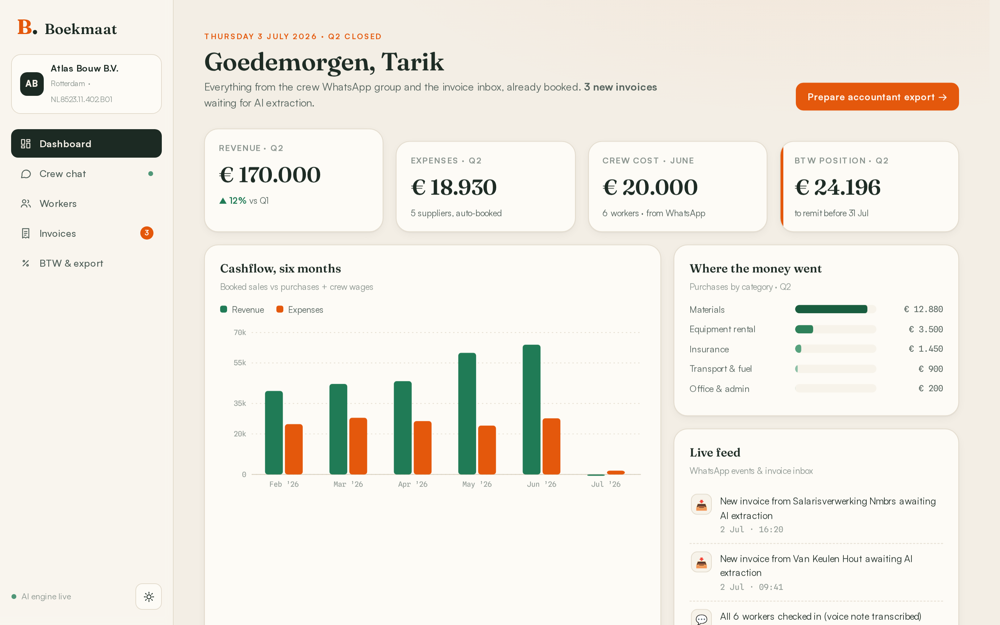
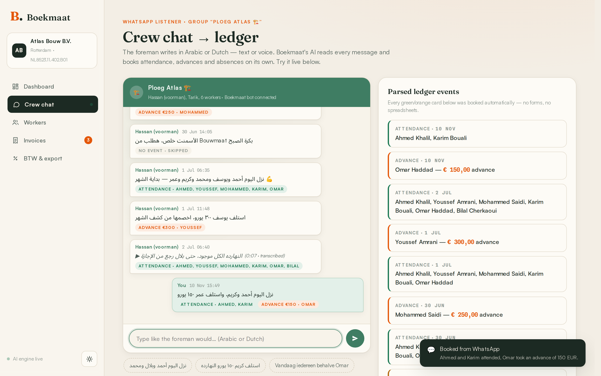
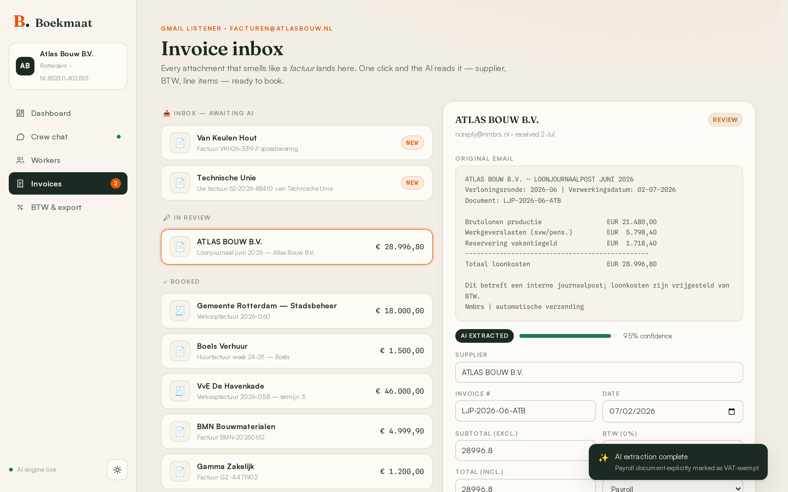

# Boekmaat: AI bookkeeping for a construction company

The foreman writes in the crew WhatsApp group, *"نزل اليوم أحمد وكريم، واستلف عمر ١٥٠ يورو"* (Ahmed and Karim came in today, Omar took a €150 advance), and Boekmaat books two attendance days and a €150 advance. No forms, no spreadsheets.

Supplier invoices arrive as messy Dutch emails. One click and the AI reads the supplier, invoice number, VAT (BTW) and line items, with a confidence score per field. At quarter end the VAT position is already reconciled and four CSVs are ready for the accountant.



## What it does

- **Crew chat to ledger.** Type like the foreman, in Arabic or Dutch. The AI matches names against the worker roster and books attendance, advances and absences. Small talk is recognised and skipped. It handles Arabic-Indic numerals and phrases like "everyone except Omar".
- **Payroll from check-ins.** Day-rate pay per worker, computed from the WhatsApp check-ins, with a monthly statement for each worker.
- **Invoice inbox.** Raw invoice emails, including a deliberately messy one and a payroll journal, become structured entries you review, edit and book.
- **VAT and export.** Quarterly BTW reconciliation (21%, 9%, exempt) computed live from booked entries, plus one-click CSV handover for sales, purchases, payroll and VAT.




## Design choice

The AI reads and classifies; it does not do the accounting. Fields it extracts from an invoice go through a review step before booking, and every total, payroll figure and VAT position is then calculated in code from the booked entries.

## Run it

Requires Node 22 or newer (it uses the built-in `node:sqlite`, so there are no native dependencies).

```bash
npm install
OPENROUTER_API_KEY=your-key npm start   # http://localhost:4780
```

The database seeds itself on first start with sample data for a fictional Rotterdam builder; `npm run seed` resets it. Without a key the app runs on the seed data, and the two AI actions report that the key is missing. The model defaults to `deepseek/deepseek-chat` and can be changed with `AI_MODEL`.

## Tests

```bash
npm install && npx playwright-core install chromium
npm start &        # server on :4780
npm run e2e        # Playwright: drives every page and both AI calls, then saves screenshots/
```

## Stack

Node 22, Express, `node:sqlite`, a vanilla JavaScript single-page app with hand-drawn SVG charts and light and dark themes, OpenRouter for the AI calls in JSON mode, Playwright for the end-to-end test.

Atlas Bouw B.V., its workers and every invoice are fictional sample data. Supplier names appear only to make the sample invoices realistic.
